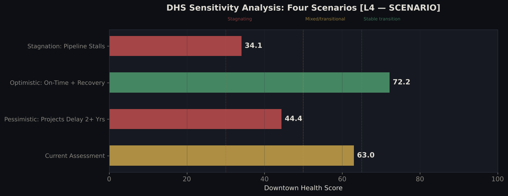

# Downtown Winnipeg Transition Analysis  
## Reimagining Downtown Winnipeg: A Multi-Billion Dollar Transition From Retail to Residential (2010–2026)

**Troy Dela Rosa**

**Downtown Winnipeg isn't dying. It's being rebuilt into something different, and the results may not show up until 2027 or 2028.**

This analysis is intended for city planners, developers, local business groups, and civic stakeholders evaluating downtown redevelopment strategy.

Major projects, including the Portage Place redevelopment and the former Bay building conversion, are driving a broader pipeline of more than $2B in planned, committed, and phased downtown investment. Not all of that investment is actively under construction today. Estimates are compiled from public announcements and may include multi-phase projects.

More than 1,600 new apartments are confirmed, with additional units proposed. Office vacancy has more than doubled since 2016. Retail activity is estimated to be down about 63% from its 2013 peak. These are not contradictory signals. They are the same story at different points in time.

The cranes are real. The empty storefronts are real. The question is whether the planned pipeline turns into completed housing, foot traffic, and street-level recovery.

**In short:** Downtown Winnipeg is in the messy middle of a multi-billion dollar transformation that may not be fully visible on the street for another two years.

## Business Question

Is downtown Winnipeg in decline, or is it moving through a delayed transition from office and retail dependence toward residential, institutional, and mixed-use activity?

## Executive Snapshot

| Metric | Finding |
|---|---|
| Redevelopment pipeline | $2B+ planned, committed, and phased investment |
| New apartments confirmed or proposed | 1,635–1,793 units |
| Office space sitting empty | 18.6% in 2025 |
| Retail activity vs. 2013 | Estimated down ~63% (reconstructed base year) |
| Downtown Health Score | 63 / 100, constructed scenario index, mixed performance, not structural decline |

The **Downtown Health Score** is a constructed scenario index combining business activity, residential growth, investment pipeline strength, spatial concentration, and office vacancy pressure. It is not an official city metric. It is used here as a directional way to compare whether downtown is improving, stagnating, or worsening.

## Downtown Health Score Methodology

The **Downtown Health Score (DHS)** is a constructed 0–100 scenario index used to summarize downtown Winnipeg’s current condition and near-term trajectory.

It combines five dimensions of downtown performance:

- Business Stability
- Residential Demand
- Investment Pipeline
- Spatial Anchoring
- Vacancy & Distress

The DHS is **not an official city metric** and is not a predictive model. It is a directional synthesis tool designed to evaluate multiple signals together rather than treat vacancy, business activity, housing, and investment as separate stories.

### Formula

DHS =  
0.25 × Business Stability  
+ 0.25 × Residential Demand  
+ 0.25 × Investment Pipeline  
+ 0.15 × Spatial Anchoring  
− 0.10 × Vacancy & Distress

The four positive components are scored on a 0–100 scale. Vacancy & Distress is scored on a 0–10 scale and applied as a penalty to reflect the negative impact of office vacancy on downtown perception, leasing activity, and investment risk.

### Current Score

**DHS = 63 / 100**  
**Band: Mixed / Transitional (50–64)**

| Component | Score | Interpretation |
|---|---:|---|
| Residential Demand | 92 | Strong forward growth signal |
| Investment Pipeline | 78 | High, but dependent on execution |
| Spatial Anchoring | 72 | Concentrated redevelopment corridor |
| Business Stability | 42 | Weak current street-level activity |
| Vacancy & Distress | 8 / 10 (applied as a penalty) | Ongoing office vacancy pressure |

**Check the math:** (0.25 × 42) + (0.25 × 92) + (0.25 × 78) + (0.15 × 72) − (0.10 × 8) = 10.5 + 23.0 + 19.5 + 10.8 − 0.8 = **63.0**

**How each component is set:** Residential Demand is calculated from the housing pipeline: completed units and pipeline units are each scaled to 0–100 (capped at 100) and combined with a population signal. Business Stability, Investment Pipeline, Spatial Anchoring and Vacancy & Distress are assessed scores based on the sources in the registry, not calculated values. Because vacancy is scored 0–10, its maximum penalty is 1 point.

This combination suggests that downtown Winnipeg is not in structural decline, but it has not yet realized the street-level benefits of its redevelopment pipeline.

### Scenario Sensitivity

| Scenario | DHS |
|---|---:|
| On-time delivery | ~72 |
| Current baseline | 63 |
| 2+ year delay | ~44 |
| Pipeline stall | ~34 |

The model is most sensitive to **Residential Demand** and **Investment Pipeline**, which together account for half of the score. This means the outlook depends less on today’s empty storefronts alone and more on whether major housing and mixed-use projects are completed, occupied, and connected to street-level activity.

**Weight check:** with equal 20% weights on all five components, the baseline score is 55.2, still inside the Mixed / Transitional band (50–64). The conclusion does not depend on the chosen weights.

### Limitations

The DHS depends on assumptions, normalization choices, and theory-driven weights. Four of its five components are assessed scores rather than calculated values, and the vacancy penalty is deliberately small. It should be used for directional scenario comparison, not precise measurement. It is not directly comparable across other cities without recalibrating the inputs and weights.

## Office Vacancy Has More Than Doubled, But the Sharpest Increase Has Slowed

Vacancy rose from 8.7% in 2016 to 18.6% in 2025. However, the pace slowed sharply in 2024–2025, rising just 0.3 percentage points across both years. The sharpest phase of the increase appears to have slowed.

## Restaurants Are Recovering. Retail Is Not.

Retail activity is estimated to be down about 63% from its 2013 peak, which helps explain the visible empty storefronts. The 2013 baseline falls in the low-confidence, reconstructed part of the series, so the 63% figure shows the direction and rough size of the decline, not an exact measurement. Food and service activity has recovered faster than retail since COVID. The data supports the visible recovery in downtown food, cafe, and service activity.

## The Construction Is Concentrated in Six City Blocks

Most major redevelopment activity is concentrated along Portage Avenue between the former Bay building and True North Square. Walk east into the Exchange District and the picture looks different. Downtown is not behaving as one uniform place. It is splitting into corridors with different levels of investment, activity, and transition pressure.

## It All Depends on Whether the Buildings Get Finished

If projects finish on time and people move in, the Downtown Health Score could reach **72 out of 100**. If construction is delayed by two or more years, it could fall to **44**.

The empty storefronts are unlikely to fill back up before the new residential base arrives. That means the transition may not become visible at street level until 2027 or 2028.

## Implications

- Prioritize completion of major residential projects so new population density reaches street-level businesses sooner.
- Support interim retail activation through pop-ups, short-term leases, and small business incentives while construction is still ongoing.
- Concentrate public realm, safety, and streetscape improvements along the Portage Avenue redevelopment corridor where investment is already clustered.
- Track vacancy, business openings, and residential occupancy together rather than treating each indicator separately.
- Treat downtown as a transition system, not a single success-or-failure story.

## Final Takeaway

Downtown is not failing. It is lagging its own transformation timeline.

This analysis builds on a growing local conversation about downtown Winnipeg's future. Recent reporting has increasingly framed major projects like Portage Place and the former Bay building not as a return to the old retail model, but as part of a broader shift toward housing, institutional uses, and adaptive reuse.

This project adds a data-based framework for connecting those redevelopment stories to vacancy trends, business activity, spatial concentration, and delivery timing.

## Design Decisions

Each choice below is one I'd expect to be asked about, so here is the reasoning behind it.

**One question, framed as decline vs. transition.**
Most downtown coverage asks "is downtown dying?" That can only be answered one metric at a time, and every metric gives a different answer. Framing it as "decline, or a delayed transition?" tests whether signals that look contradictory (empty storefronts and cranes) are the same story at different points in time.

**A composite score instead of a single headline metric.**
Vacancy alone says downtown is getting worse. The housing pipeline alone says it is getting better. Neither is the full picture, so the Downtown Health Score combines five signals into one number. It is a way to compare scenarios, not a measurement, and it is labelled that way everywhere it appears.

**Assessed scores where the data can't calculate one.**
Only residential demand has enough project-level data to calculate a score. For business stability, investment pipeline, spatial anchoring and vacancy, the sources describe conditions but don't produce a single comparable number, so those are assessed from the source registry and stated openly. This is the main reason the DHS is a scenario tool, not a measurement.

**Weights set by reasoning, not fitted to data.**
There is no historical "downtown health" outcome to train against, so the weights could not be learned from data. Business stability, residential demand and investment pipeline each carry 25% because each one alone can change the street-level outcome; spatial anchoring carries 15% because it answers where the renovations are happening: most of the redevelopment is the remodelling of old, existing buildings, and the project map shows it concentrated along Portage Avenue, so where those buildings sit shapes what changes on the street; vacancy is applied as a 10% penalty. With equal weights the baseline moves from 63 to 55.2 but stays in the same band, so the conclusion does not rest on these exact weights.

**Vacancy as a small penalty, not a positive component.**
High vacancy hurts perception, leasing and investment risk, so it subtracts from the score instead of being inverted and added like the other four. It is scored 0–10, which caps its effect at 1 point. Vacancy depends heavily on which part of downtown you look at, but the CBRE rate is a single downtown-wide figure, so it is kept as a small penalty rather than a full component.

**Scenarios instead of a forecast.**
The outcome depends mostly on whether planned projects are finished and occupied, which 15 years of history can't predict. So instead of forecasting one number, each scenario sets the five component scores to reflect a delivery outcome (for example, a 2+ year delay cuts residential demand by 40%), and the score is recalculated. The scenario inputs are assumptions, not model outputs. The spread between them (~72 to ~34) is the finding: the outlook depends on execution, not on today's storefronts.

**2013 as the baseline for business activity.**
2013 is the peak year in the series, so comparing to it shows the full size of the retail decline and makes the faster food and service recovery visible against the same reference point. The trade-off: 2013 sits in the reconstructed, low-confidence period, so the size of the decline is approximate even though the direction is clear.

**Keep estimated years, but label them.**
CBRE vacancy data was missing for 4 of 10 years, and business activity before 2021 had to be reconstructed from supporting sources. Dropping those years would have hidden the trend, so they stay in, flagged as estimates, and conclusions are written as directional rather than exact. Every source is listed in the source registry below.

**Map the projects instead of treating downtown as one place.**
Averages across all of downtown hid the most important pattern: investment is concentrated in roughly six blocks of Portage Avenue, while the Exchange District looks different. Mapping the projects turned "downtown" into corridors with different needs, which is where the implications come from.

**Implications, not instructions.**
The data supports directions (finish housing first, activate empty retail in the meantime, focus streetscape work where investment already is). It does not support costed recommendations, so the section is called Implications on purpose.

## About the Data

Vacancy figures are based on CBRE market reports, with 4 of 10 years estimated. Business activity before 2021 was reconstructed from supporting sources and should be treated as directional rather than exact. Investment amounts were compiled from press releases and public reporting.

Full source registry: [`data/downtown_wpg_sources_2026.csv`](data/downtown_wpg_sources_2026.csv)

**To run:** Open `notebooks/downtown_winnipeg_transition_analysis.ipynb`

### Technical Overview

- **Pipeline:** Data cleaning with pandas → trend analysis → scenario modeling → stakeholder visualization.
- **Key logic:** The Downtown Health Score is a constructed index combining residential growth, vacancy pressure, business activity, investment pipeline strength, and spatial concentration. Residential demand is calculated; the other components are assessed.
- **Prediction demo:** Section 8 fits a small decision tree to the 7 named housing projects to demonstrate a scikit-learn workflow. With a 3-row test set, its accuracy (0.33) is not meaningful, and no conclusions are drawn from it.
- **Environment:** Python 3.11+, with `conda` or `venv` recommended.
